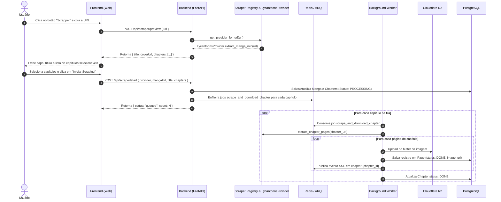

# Especificação Técnica: Módulo Web Scraper & Provider Strategy

## 1. Visão Geral

Este documento define a arquitetura e os requisitos técnicos para a adição de um módulo modular de **Web Scraping** na aplicação Ogma.
O módulo permitirá extrair metadados e capítulos de obras de mangás/manhwas/manhuas a partir de múltiplos provedores web, iniciando com o suporte ao **LycanToons**, integrado diretamente ao ecossistema existente de processamento em segundo plano (ARQ/Redis), armazenamento em nuvem (Cloudflare R2) e visualização em tempo real (SSE e Leitor Web).

---

## 2. Requisitos e Escopo

### 2.1 Backend (`apps/api`)
- **Arquitetura de Provedores (Provider Strategy)**: Estrutura extensível de provedores para que novas fontes de mangás possam ser adicionadas sem alterar a lógica de orquestração.
- **Provedor LycanToons (`LycantoonsProvider`)**:
  - Extração de metadados da obra (título, capa, quantidade total de capítulos, lista ordenada de capítulos).
  - Extração das URLs das imagens de cada capítulo com bypass de proteções do Cloudflare (User-Agent, TLS e modo headless stealth com Playwright).
  - Download das imagens diretamente para o Cloudflare R2 sem passar por tradução de IA por padrão (já que as obras do provedor se encontram em PT-BR), mantendo compatibilidade com flag opcional de tradução.
- **Novos Endpoints da API**:
  - `POST /api/scraper/preview`: Valida a URL, localiza o provedor registrado e retorna a prévia da obra (título, capa e lista de capítulos).
  - `POST /api/scraper/start`: Cria/atualiza os registros de `Manga` e `Chapter` no PostgreSQL e enfileira jobs granulares no ARQ para cada capítulo selecionado.
- **Fila ARQ & Notificação**:
  - Nova função de job `scrape_and_download_chapter` registrada no `WorkerSettings`.
  - Notificação de progresso página a página via canal Redis PubSub `chapter:{chapter_id}` para atualização em tempo real por Server-Sent Events (SSE).

### 2.2 Frontend (`apps/web`)
- **Botão "Scrapper"**:
  - Localizado na página inicial (`Home.tsx`) ao lado do botão "Baixar Novo".
- **Modal de Scraping (`ScraperModal.tsx`)**:
  - Campo de entrada para a URL da obra.
  - Validação em tempo real junto ao backend. Se a URL não pertencer a nenhum provedor suportado, exibe mensagem clara de erro.
  - Exibição de card da obra identificada (título, capa) e lista de capítulos com checkboxes de seleção individual e botão "Selecionar Todos".
  - Botão de confirmação "Iniciar Scraping".
- **Integração com Biblioteca e Leitor**:
  - Os capítulos raspados são listados na biblioteca existente (`MangaAccordion.tsx`) com barra de progresso em tempo real.
  - A leitura das páginas raspadas ocorre de forma idêntica às obras do MangaDex no componente `ReaderComponent.tsx`.

---

## 3. Arquitetura do Sistema

### 3.1 Diagrama de Fluxo



---

## 4. Estrutura de Arquivos

```
apps/api/
├── src/
│   ├── scrapers/
│   │   ├── __init__.py
│   │   ├── base.py                 # Classes abstratas BaseProvider e DTOs (Pydantic)
│   │   ├── registry.py             # Registro e resolução de provedores
│   │   ├── browser.py              # Gerenciador de contexto do Playwright com stealth
│   │   └── providers/
│   │       ├── __init__.py
│   │       └── lycantoons.py       # Implementação do LycanToons
│   ├── main.py                     # Novos endpoints /api/scraper/preview e /api/scraper/start
│   └── worker.py                   # Nova task scrape_and_download_chapter no ARQ
└── requirements.txt                # Adição de playwright

apps/web/
├── src/
│   ├── components/
│   │   └── ScraperModal.tsx        # Modal de input de URL, preview e seleção de capítulos
│   ├── pages/
│   │   └── Home.tsx                # Inclusão do botão "Scrapper" e acionamento do modal
│   └── api.ts                      # Funções previewScraper e startScraper
```

---

## 5. Detalhamento dos Componentes

### 5.1 `apps/api/src/scrapers/base.py`
Define as estruturas de dados (DTOs) e o contrato abstrato dos provedores:
```python
from abc import ABC, abstractmethod
from pydantic import BaseModel

class ChapterItem(BaseModel):
    id: str
    number: str
    title: str | None = None
    url: str

class MangaPreview(BaseModel):
    provider: str
    manga_id: str
    title: str
    cover_url: str | None = None
    chapters: list[ChapterItem]

class PageItem(BaseModel):
    page_index: int
    image_url: str

class BaseProvider(ABC):
    name: str

    @abstractmethod
    def can_handle(self, url: str) -> bool:
        """Determina se a URL fornecida pertence a este provedor."""
        pass

    @abstractmethod
    async def extract_manga_info(self, url: str) -> MangaPreview:
        """Extrai os metadados da obra e a lista de capítulos."""
        pass

    @abstractmethod
    async def extract_chapter_pages(self, chapter_url: str) -> list[PageItem]:
        """Extrai as páginas/imagens de um capítulo específico."""
        pass
```

### 5.2 `apps/api/src/scrapers/providers/lycantoons.py`
Implementa a extração específica do LycanToons:
- **Identificação**: Reconhece URLs que contenham `lycantoons.com/series/`.
- **Extração da Obra**:
  - Extrai o slug da URL.
  - Acessa a página da obra utilizando o navegador headless com Playwright (ou faz parsing do payload RSC embutido no HTML inicial gerado pelo Next.js).
  - Extrai `title`, `coverUrl` e a lista completa de capítulos ordenados crescentemente por número.
- **Extração do Capítulo**:
  - Acessa a página do capítulo (`https://lycantoons.com/series/{slug}/{numero}`).
  - Coleta as URLs completas das imagens hospedadas na CDN (`https://cdn.lycantoons.com/file/lycantoons/...`).

### 5.3 Novos Endpoints da API (`main.py`)
- **`POST /api/scraper/preview`**
  - **Body**: `{ "url": "https://lycantoons.com/series/a-empregada-secreta-do-conde" }`
  - **Resposta de Sucesso (200)**:
    ```json
    {
      "supported": true,
      "provider": "lycantoons",
      "mangaId": "lycantoons:a-empregada-secreta-do-conde",
      "title": "A Empregada Secreta do Conde",
      "coverUrl": "https://cdn.lycantoons.com/file/lycantoons/covers/cover-1786784019028.webp",
      "chapters": [
        { "id": "lycantoons:a-empregada-secreta-do-conde:1", "number": "1", "title": "Capítulo 1", "url": "https://lycantoons.com/series/a-empregada-secreta-do-conde/1" }
      ]
    }
    ```
  - **Resposta de Erro (400)**: URL inválida ou nenhum provedor suportado.

- **`POST /api/scraper/start`**
  - **Body**:
    ```json
    {
      "provider": "lycantoons",
      "mangaId": "lycantoons:a-empregada-secreta-do-conde",
      "title": "A Empregada Secreta do Conde",
      "chapters": [
        { "id": "lycantoons:a-empregada-secreta-do-conde:1", "number": "1", "url": "https://lycantoons.com/series/a-empregada-secreta-do-conde/1" }
      ],
      "forceTranslate": false
    }
    ```
  - **Ação**: Cria/atualiza o `Manga` e `Chapter` no banco e despacha os jobs para o Redis ARQ.

### 5.4 Worker ARQ (`worker.py`)
- Nova função assíncrona:
  `async def scrape_and_download_chapter(ctx, provider_name: str, chapter_id: str, chapter_url: str, force_translate: bool = False)`
- Passos:
  1. Utiliza o provedor para obter `list[PageItem]`.
  2. Cria os registros na tabela `Page` com status `PROCESSING`.
  3. Para cada página, realiza o download da imagem via sessão do browser/stealth e faz upload diretamente para o R2 (`{chapter_id}/{page_index}.png`).
  4. Atualiza a `Page` no banco de dados com `status = TranslationStatus.DONE` e `image_url`.
  5. Emite evento Redis SSE (`chapter:{chapter_id}`).
  6. Ao concluir todas as páginas, atualiza `Chapter.status = TranslationStatus.DONE`.

---

## 6. Tratamento de Erros e Casos de Borda

1. **Bloqueio Cloudflare WAF**:
   - O módulo Playwright utiliza User-Agent moderno, desabilita a flag `navigator.webdriver` e aborta requisições de anúncios (`pubadx`, scripts de rastreamento) para acelerar a carga de páginas e não acionar rate-limits.
2. **Capítulo sem páginas ou erro de rede temporário**:
   - Se o scraping de um capítulo falhar, o capítulo é marcado com `status = TranslationStatus.ERROR` no banco de dados, permitindo reexecução via botão de retry já existente na interface.
3. **Downloads parciais e idempotência**:
   - Se páginas já existirem no Cloudflare R2 com status `DONE`, o worker reutiliza os dados existentes sem baixar novamente.

---

## 7. Estratégia de Testes

- **Testes Unitários / Integração Backend (`pytest`)**:
  - Testar o `ProviderRegistry` com URLs válidas e inválidas.
  - Testar o parsing e extração do `LycantoonsProvider` garantindo que títulos, capítulos e URLs de imagens sejam montados corretamente.
  - Testar os endpoints `/api/scraper/preview` e `/api/scraper/start`.
- **Testes de Componentes Frontend (`vitest`)**:
  - Testar a renderização do `ScraperModal`.
  - Testar seleção e deseleção de capítulos no modal.
  - Testar chamada da API com URLs suportadas e erro em URLs desconhecidas.
