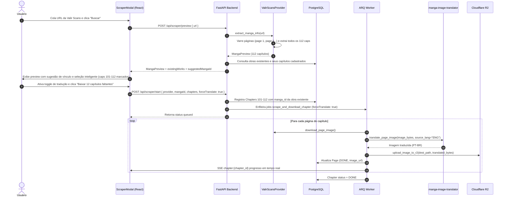

# Especificação Técnica: Vinculação Multi-Provedores e Provedor Valir Scans

## 1. Visão Geral

Este documento detalha o design arquitetural para permitir a vinculação de múltiplos provedores web de mangás (scans secundárias/estrangeiras) a uma mesma obra já registrada na biblioteca do Ogma, com identificação inteligente e download exclusivo dos capítulos faltantes/restantes, além de suporte à tradução automática de scans em língua estrangeira e inclusão do novo provedor **Valir Scans** (`valirscans.org`).

### Caso de Uso Principal
* Uma obra já cadastrada no banco de dados (ex: `lycantoons:a-empregada-secreta-do-conde` - *"A Empregada Secreta do Conde"*) possui 100 capítulos em português (capítulos 1 a 100).
* O usuário encontra uma scan gringa em inglês (`https://valirscans.org/series/comic/the-counts-secret-maid?page=2`) que possui 112 capítulos no total (portanto, com capítulos 101 a 112 ainda inéditos na biblioteca).
* Ao colar a URL no Scraper, o sistema:
  1. Varre automaticamente a obra completa em todas as suas páginas na scan externa;
  2. Sugere vincular à obra existente *"A Empregada Secreta do Conde"*;
  3. Desmarca os 100 capítulos já existentes (marcando-os com badge visual *"Já baixado"*);
  4. Pré-seleciona os 12 capítulos faltantes (101 a 112) com badge *"Novo"*;
  5. Oferece opção de tradução automática (EN ➔ PT-BR) com OCR & IA antes de salvar no Cloudflare R2;
  6. Salva os novos capítulos associados à obra existente na biblioteca, mantendo unificada a leitura e o histórico.

---

## 2. Arquitetura do Sistema

### 2.1 Diagrama de Sequência



---

## 3. Especificação dos Componentes

### 3.1 Provedor `ValirScansProvider` (`apps/api/src/scrapers/providers/valirscans.py`)

Herda de [`BaseProvider`](file:///home/daviribeiro/projects/personal/ogma/apps/api/src/scrapers/base.py) e implementa:
1. **`name = "valirscans"`**
2. **`can_handle(url: str) -> bool`**:
   - Retorna `True` para URLs que contenham `valirscans.org/series/comic/` ou `valirscans.org/series/novel/`.
3. **`extract_manga_info(url: str) -> MangaPreview`**:
   - Limpa parâmetros de query para obter a URL base canônica: `https://valirscans.org/series/comic/{slug}`.
   - Faz a requisição da página inicial e analisa o HTML:
     - Extrai o título da obra (tag `<h1>` ou meta tags OpenGraph `og:title`).
     - Extrai a URL da capa (`og:image` ou ``).
     - Identifica a paginação de capítulos (ex: links `?page=2`, `?page=3`, etc.).
   - Itera sequencialmente ou concorrentemente pelas páginas adicionais até que não haja mais capítulos ou a página repita capítulos já vistos.
   - Constrói a lista ordenada de [`ChapterItem`](file:///home/daviribeiro/projects/personal/ogma/apps/api/src/scrapers/base.py#L8):
     - `id`: `f"valirscans:{slug}:{ch_number}"`
     - `number`: string normalizada do número do capítulo (ex: `"101"`, `"102"`)
     - `title`: Título do capítulo ou `f"Capítulo {ch_number}"`
     - `url`: URL absoluta do capítulo (ex: `https://valirscans.org/series/comic/{slug}/chapter/{ch_number}`)
   - Retorna a lista completa ordenada numericamente (1 ao 112).
4. **`extract_chapter_pages(chapter_url: str) -> list[PageItem]`**:
   - Acessa o HTML do capítulo.
   - Extrai as URLs das páginas de imagem hospedadas no subdomínio CDN (`https://media.valirscans.org/series/{slug}/{ch_padded}/p-...webp`).
   - Retorna a lista indexada de [`PageItem(page_index=i, image_url=url)`](file:///home/daviribeiro/projects/personal/ogma/apps/api/src/scrapers/base.py#L23).
5. **`download_page_image(image_url: str) -> bytes`**:
   - Executa GET via `httpx.AsyncClient` com headers simulando navegador (`User-Agent`, `Referer: https://valirscans.org/`).
   - Retorna os bytes da imagem.

---

### 3.2 Endpoints da API (`apps/api/src/main.py`)

#### 1. `POST /api/scraper/preview`
* **Modelos**:
  ```python
  class ExistingMangaSummary(BaseModel):
      id: str
      title: str
      existingChapterNumbers: list[str]

  class ScraperPreviewResponse(BaseModel):
      supported: bool
      provider: str
      mangaId: str
      title: str
      coverUrl: str | None
      chapters: list[ChapterItem]
      existingWorks: list[ExistingMangaSummary]
      suggestedMangaId: str | None
  ```
* **Lógica de Matching / Sugestão**:
  - Busca todos os `Manga` registrados com seus `Chapter.chapter_number`.
  - Compara o título do preview (ex: `"The Count's Secret Maid"`) com os títulos da biblioteca (ex: `"A Empregada Secreta do Conde"`):
    - Normaliza strings (minúsculas, remoção de pontuação e stop words).
    - Executa cálculo de similaridade (`difflib.SequenceMatcher` ou token overlap).
    - Caso encontre score acima do limiar (ou se o slug/nome coincidir), define `suggestedMangaId`.

#### 2. `POST /api/scraper/start`
* **Entrada**:
  ```python
  class ScraperStartRequest(BaseModel):
      provider: str
      mangaId: str  # ID da obra selecionada (pode ser a existente ou nova)
      title: str
      chapters: list[ChapterItem]
      forceTranslate: bool = False
  ```
* **Comportamento**:
  - Se `mangaId` já existe na tabela `mangas`:
    - Preserva o título existente (não sobrescreve o título em português).
  - Se não existe:
    - Cria o novo registro `Manga(id=mangaId, title=title)`.
  - Para cada capítulo selecionado em `chapters`:
    - Cria ou atualiza o registro `Chapter(id=ch.id, manga_id=mangaId, chapter_number=str(ch.number), status=TranslationStatus.PROCESSING)`.
    - Limpa chave de cache do ARQ `arq:result:{job_id}`.
    - Enfileira `scrape_and_download_chapter(provider, ch.id, ch.url, forceTranslate, _job_id=job_id)`.

---

### 3.3 Worker & Pipeline de Tradução (`apps/api/src/worker.py`)

1. **Função Auxiliar de Tradução Reutilizável**:
   ```python
   async def translate_page_image(image_bytes: bytes, source_lang: str = "ENG") -> bytes:
       # Envia a imagem para o manga-image-translator via WORKER_ML_URL/submit
       # Utiliza as configurações de OCR e modelo com prompt profissional em PT-BR
       # Retorna os bytes da imagem traduzida
   ```
2. **Execução no Job `scrape_and_download_chapter`**:
   - Ao iterar sobre `provider.download_pages(pages)`:
     - Se `force_translate == True`:
       - `final_bytes = await translate_page_image(image_bytes, source_lang="ENG")`
     - Se `force_translate == False`:
       - `final_bytes = image_bytes`
     - Salva no Cloudflare R2 com `upload_image_to_r2(final_bytes, dest_path)`.
     - Atualiza status da `Page` para `DONE` e define `image_url`.
     - Emite evento SSE via Redis `chapter:{chapter_id}`.
   - Ao finalizar todas as páginas, marca `Chapter.status = TranslationStatus.DONE`.

---

### 3.4 Interface do Usuário (`apps/web/src/components/ScraperModal.tsx`)

1. **Card de Obra e Seletor de Destino**:
   - Card com thumbnail, título raspado e contagem total de capítulos.
   - Bloco de seleção **"Vincular à obra na biblioteca"**:
     - Botão/Radio de seleção:
       - `[X] Vincular a: "A Empregada Secreta do Conde" (Sugerido)` (se houver correspondência).
       - `[ ] Criar como nova obra ("The Count's Secret Maid")`.
       - `[ ] Outra obra...` (dropdown de busca com todas as obras da biblioteca).
2. **Detecção e Badges de Capítulos**:
   - Conforme a obra selecionada muda:
     - Recalcula os capítulos já existentes: se o número do capítulo pertencer a `existingChapterNumbers`, adiciona badge *"Já baixado"* (cinza/muted) e desmarca o checkbox.
     - Se for inédito, adiciona badge *"Novo"* (destaque verde/primary) e marca o checkbox.
3. **Barra de Ações Rápidas**:
   - Botão **"Selecionar apenas faltantes"**: redefine a seleção marcando exclusivamente os capítulos que não possuem a badge *"Já baixado"*.
   - Botão **"Marcar todos" / "Desmarcar todos"**.
   - Contador informativo: *"12 novos capítulos selecionados (100 já baixados ignorados)"*.
4. **Opção de Tradução**:
   - Checkbox com label: *"Traduzir páginas automaticamente (EN ➔ PT-BR) com OCR & IA"*.
   - Marcado por padrão quando o provedor é estrangeiro (`valirscans`).
5. **Ação de Importação**:
   - Botão principal: *"Baixar 12 capítulos selecionados"*.
   - Ao clicar, chama `api.startScraper(...)`, exibe notificação toast e invalida o cache da biblioteca.

---

## 4. Tratamento de Erros e Casos de Borda

1. **Paginação sem Fim / Loops**:
   - O `ValirScansProvider` mantém um conjunto de slugs/números de capítulos já visitados (`visited_chapters`). Se uma página subsequente não trouxer novos capítulos ou repetir os já existentes, a varredura encerra com segurança.
2. **Proteção Cloudflare / Headers de Requisição**:
   - Requisições ao CDN de imagens (`media.valirscans.org`) exigem headers `User-Agent` e `Referer: https://valirscans.org/`. Caso ocorra erro HTTP 403, o método `download_page_image` utiliza o Playwright stealth já configurado na imagem Docker.
3. **Falha Pontual de Tradução de IA**:
   - Se a tradução de uma página falhar por timeout ou erro no container de ML, o sistema faz fallback para a imagem original em inglês e registra aviso no log, garantindo que o capítulo não fique corrompido ou incompleto para o leitor.
4. **Idempotência no Enfileiramento**:
   - O worker continua limpando chaves `arq:result:{job_id}` antes de enfileirar, permitindo reimportar ou tentar novamente capítulos específicos sem conflito.

---

## 5. Estratégia de Testes

1. **Testes Unitários Backend (`pytest`)**:
   - `test_valirscans_provider.py`: valida `can_handle`, regex de paginação, extração de metadados com mocks de HTML e extração de URLs de páginas do capítulo.
   - `test_scraper_api_linking.py`: valida endpoint `/api/scraper/preview` com retorno de `existingWorks`, `suggestedMangaId` e cálculo de capítulos existentes.
   - `test_scraper_start_linking.py`: valida que `/api/scraper/start` associa corretamente `Chapter.manga_id` à obra existente sem sobrescrever o título original.
   - `test_worker_scrape_translate.py`: valida a integração de `force_translate` chamando `translate_page_image`.
2. **Testes Unitários Frontend (`vitest`)**:
   - `ScraperModal.test.tsx`: valida exibição do seletor de obras existentes, marcação automática dos capítulos faltantes com badge *"Novo"*, badge *"Já baixado"* nos existentes e envio do `mangaId` correto no clique de confirmação.
